# EMPATHO — 유방암 검진 경로 CDSS

> 팀 프로젝트의 공개 사본입니다. 원본은 [medical-ai-group-3/empatho](https://github.com/medical-ai-group-3/empatho)입니다.
> 커밋 기록과 작성자는 원본과 같습니다. 개인 개발 도구 설정 파일만 기록에서 지웠습니다.

유방 영상(맘모그래피, 초음파, MRI)과 병리 슬라이드를 AI가 판독해 의사의 판독을 돕는 병원용 웹 서비스입니다.
AI 결과는 모두 제안입니다. 최종 판정은 의사가 합니다.

| 항목 | 내용 |
|---|---|
| 기간 | 2026.08 ~ 2026.10 |
| 인원 | 5명 (팀장: Yun-sooyong) |
| 결과 | 미래융합교육원 바이오메디컬 AI 과정 최종 프로젝트 우수상 |
| 내 역할 | 통합 추론 서버, 판독 파이프라인, 인프라, 자동 배포 |

## 핵심 가치

1. **GPU 1대로 4개 영상 판독:** MedSAM3 백본 1벌을 메모리에 두고, 영상 종류마다 LoRA 어댑터만 바꿉니다.
2. **소견문 수치를 LLM이 바꾸지 못함:** 판독 수치는 코드가 문장으로 만듭니다. LLM은 문장을 잇기만 합니다. 수치가 바뀌면 코드가 만든 문장으로 되돌립니다.
3. **환자 정보 분리:** 추론 서버에는 환자 식별자를 보내지 않습니다. 추론 서버는 외부에 포트를 열지 않고 SSH 터널로만 연결됩니다.

## 내가 만든 것과 결과

| 한 일 | 결과 |
|---|---|
| 영상 종류별 모델을 백본 1벌 + LoRA 교체 구조로 합침 | GPU 메모리 13,602MiB → 4,148MiB (약 70% 감소) |
| LoRA 어댑터 교체 | 교체 시간 0.06~0.28초, 교체 전후 결과가 비트 단위로 같음 |
| 소견문 서버 (Ollama, `gemma3:12b-it-q4_K_M`) | 같은 입력 50회 생성에서 50회 같은 결과, 판독 수치 150개 보존 |
| Celery + Redis 판독 파이프라인, 알림과 본인인증 백엔드 | 판독 요청을 작업 큐로 처리 |
| GitHub Actions 자동 배포 | 바뀐 폴더만 배포, 추론 서버는 실패 시 이전 커밋으로 롤백 |

## 구조

| 서버 | 구성 |
|---|---|
| 앱 서버 | Django(API, DB 쓰기), Celery worker, Go 서비스(파일 게이트웨이, 실시간 알림, 소견문 중계), nginx |
| 저장소 | PostgreSQL 17, Garage v2.3.0 (S3 호환), Orthanc 26.8.1 (DICOM). 모두 `127.0.0.1`에만 바인딩 |
| 추론 서버 (GPU) | FastAPI 판독 서버(`:8001`), FastAPI 소견문 서버, Ollama. supervisor로 실행 |
| 화면 | React + Vite 병원 웹, Capacitor 안드로이드 환자 앱 |

설계 원칙은 4가지입니다.

1. DB에는 Django 코드만 씁니다. Go 서비스는 콜백으로 Django에 기록을 요청합니다.
2. 파일 바이트는 Go 게이트웨이만 다룹니다. Django가 서명한 티켓이 있어야 접근합니다.
3. 판독 서버와 소견문 서버는 실패를 HTTP 200 `abstained` 응답으로 돌려줍니다.
4. 환자 식별자는 추론 서버로 보내지 않습니다.

## 기술 스펙

| 영역 | 기술 |
|---|---|
| 백엔드 | Python 3.12, Django, DRF, Celery, Redis, Go |
| 추론 | FastAPI, PyTorch, Ollama |
| 화면 | React, Vite, Three.js, Cornerstone.js, Capacitor |
| 인프라 | Docker Compose, nginx, GitHub Actions (self-hosted 러너), supervisor, FCM |

## AI 모델

| 대상 | 모델 | 하는 일 |
|---|---|---|
| 초음파, 맘모그래피, MRI | MedSAM3 + 영상 종류별 LoRA | 병변 분할과 탐지, 유방 밀도 분할 |
| 병리 | Virchow2 기반 조직 분할 | sTIL 계측 |
| 소견문 | `gemma3:12b-it-q4_K_M` (Ollama) | 코드가 만든 문장을 이어 소견문 초안 작성 |

- 모델 가중치와 학습 데이터는 이 저장소에 없습니다.

## API

| 서버 | 경로 | 내용 |
|---|---|---|
| 판독 서버 | `POST /analyze/{socket_id}` | 영상 1건 판독 |
| 소견문 서버 | `POST /report/{socket_id}` | 판독 수치로 소견문 초안 생성 |
| 두 서버 | `GET /healthz` | 상태 확인 |
| 앱 서버 | `/api/v1/...` | 병원 업무 API (Django) |

## 폴더

| 폴더 | 내용 |
|---|---|
| `app/` | Django, Celery, Go 서비스, nginx, Docker Compose |
| `view/` | 병원 웹, 환자 앱 |
| `inference/` | 판독 서버, 소견문 서버 |
| `pathology-eval/` | 병리 모델 학습과 평가 |
| `workstation/` | GPU 워크스테이션의 학습과 후처리 코드 |

## 실행

1. 앱 서버 저장소를 실행합니다: `cd app && docker compose -f compose.server.yml up -d`
2. 화면을 목업으로 실행합니다: `cd view && npm install && npm run dev:mock`
3. 추론 서버는 GPU와 모델 가중치가 필요합니다. `inference/README.md`를 봅니다.

- 설정 파일은 `app/conf/*.env.example`을 복사해서 만듭니다. 실제 값은 Git에 넣지 않습니다.
- 폴더마다 자세한 실행 방법은 각 폴더의 `README.md`에 있습니다.

## 팀

| 팀원 | 담당 |
|---|---|
| **Yun-sooyong** (팀장) | 병리 sTIL 추론과 서빙, 판독·소견문 서버, 판독 파이프라인, 알림·본인인증 백엔드, 자동 배포, 환자 앱 |
| spgummo0905 | 맘모그래피 모델, Go 게이트웨이와 중계, nginx, 병원 업무 API와 진료 화면 |
| ilunee | 초음파 모델, DB 스키마, 권한·티켓 API, 접수·간호 화면 |
| da-hee-da | 병리 조직 분할 모델, 영상·병리 API, 가입 화면, 디자인 토큰 |
| jungeun | MRI 모델, 3D·MPR·NIfTI 뷰어, MRI 판독 화면 |
